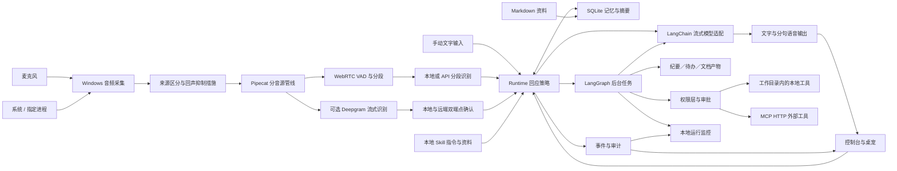

# GreatSage 实现架构

更新日期：2026-10-21。本文记录 v0.5 当前源码架构：在 v0.4 的 LangChain、LangGraph 和 MCP 基础上接入 Pipecat，保留 GreatSage 的权限、来源／删除、实时采集与桌面职责。源码、构建、真实服务和已发布版本的边界见[项目现状](project-status.md)与[v0.5 验证](validation-v0.5.md)。按功能定位文件和函数见[代码导航](code-map.md)。

## 1. 组成与调用关系

Electron 管理主窗口、桌宠、托盘和本地服务生命周期；Python 服务管理音频、模型、记忆和事件。两者通过回环 HTTP 与 WebSocket 通信。采集线程不等待 ASR 或 LLM 网络请求。

| 文件／目录 | 责任 |
| --- | --- |
| desktop/main.cjs、preload.cjs | 窗口、托盘、受限桌面接口、本地后端启动与连接凭据 |
| ui/ | 控制台、桌宠、语音播放、状态和日志展示 |
| greatsage/server.py | 有认证的本地 HTTP／WebSocket 接口与输入校验 |
| greatsage/runtime.py | 音频任务、行为预设、上下文、回复、播放与压缩调度 |
| greatsage/audio.py、winloopback.py | 麦克风、系统／进程回环、PCM 转换与线程队列 |
| greatsage/echo.py | 播放参考及自身声音抑制；不是完整 AEC |
| greatsage/segmentation.py | 30 ms VAD 帧、预留音频、临时快照、静音结束与最长分段 |
| greatsage/voice_pipeline.py | Pipecat 帧、分音源身份、串行处理、背压和关闭 |
| greatsage/voice_status.py / ui/voice.js | 共享音源元数据、恢复动作与首页／监控的故障处理入口 |
| greatsage/streaming_asr.py | 官方 Deepgram SDK 薄适配、单连接、显式语言与凭据、安全失败 |
| greatsage/providers.py | 流式 LLM、ASR、TTS、本地模型准备与受控错误 |
| greatsage/chat_models.py | LangChain OpenAI／Ollama 聊天适配，复用应用连接池与凭据 |
| greatsage/agent_graph.py | LangGraph 纪要／操作图、SQLite 控制 checkpoint 和审批恢复 |
| greatsage/mcp_tools.py | 官方 SDK 的显式发现、定义版本、参数校验与受控 HTTP 调用 |
| greatsage/inspector.py、ui/inspector.js | 本地状态、消息／上下文和记忆元数据检查 |
| greatsage/settings.py | 配置校验、环境变量、DPAPI 密钥与原子提交 |
| greatsage/memory.py | 持久化、检索、摘要、来源关系、修正与删除 |
| greatsage/skills.py | 只读技能注册、选择、版本与引用边界 |
| greatsage/semantic.py、budget.py | 版本化向量索引、混合检索与模型输入预算 |
| greatsage/decisions.py、background.py | 结构化回应策略、有限批次及失败退避 |
| greatsage/audit.py | 受控请求快照、凭据移除、导出与来源失效 |
| greatsage/materials.py（v0.3） | Markdown 导入、分块、版本、重新扫描和片段检索 |
| greatsage/artifacts.py（v0.3） | 产物版本、引用表、待办和 Markdown 导出 |
| greatsage/workflows.py（v0.3） | 纪要抽取的提示与 JSON Schema、条目清理、合并和渲染 |
| greatsage/task_store.py | 任务／步骤／工具账本的 SQLite 持久化，复用 MemoryStore 的数据库与锁 |
| greatsage/tasks.py（v0.3） | 任务执行、模型调用重试、审批、取消与恢复协调 |
| greatsage/tools.py（v0.3） | 工具定义、效果分级、授权决策、工作目录沙箱、执行与撤销 |
| ui/work.js（v0.3） | 任务、资料、产物、审批和工具设置界面 |
| ui/memory.js、audit.js | 记忆来源、冲突、历史浏览、索引和审计控件 |

存储层的 `TaskStoreMixin` 从 `task_store.py` 注入 `MemoryStore`，不再经 `tasks.py` 导入任务执行依赖。`tasks.py` 保留原符号兼容入口；表结构、事务和恢复语义保持原样。目录按当前职责组织，较大的 Runtime／路由拆分随对应功能迁移进行，避免无关搬迁。

## 2. 音频与实时响应

每个音源保留来源标记，转换为单声道 16 kHz PCM16，进入有界队列。用户选择麦克风和至多一个桌面音源；指定程序模式包括该程序的进程树。设备或进程重新启动后，应刷新并重新选择当前 ID。

每源使用 Pipecat `PipelineWorker`，VAD 产生开始、临时快照、最终片段和丢弃事件。原 API／本地路径仍以快照请求识别，最终片段串行保序；长语句达到上限后分段并保持“仍在说话”。选择 Deepgram 时，PCM 经官方 SDK 流式发送，稳定片段先聚合，需本地 VAD 结束和远端 Finalize／speech_final 同时满足才提交。临时文字不能发起回答或工具；短噪声的本地丢弃不能被云端转写升级为命令。

管线固定来源、会话与代际，有界排队并在关闭时使回调立即失效。普通分段识别丢帧后重建该源管线；流式丢帧、积压、超过 15 秒未确认、前一轮未确认时新轮次开始等情况停止该源。采集仍在运行时，显式单源重试先失效旧身份、清理旧缓冲及任务，再有界关闭并重建该源管线；只接受新的音频，不改变其他音源，不自动重连重放或换提供商。设备／进程采集停止仍要求检查来源并重新开启监听，配置错误指向设置。当前尚需真实连续会话验证这些保守边界。录音开启时额外 PCM 缓存有界；超长轮次保留文字、跳过残缺录音。

框架 tracing、RTVI、转写正文日志和环境脚本 `PIPECAT_SETUP_FILES` 均停用。Pipecat 1.13 在 Python 3.11 上使用其官方 `wait_for2` 兼容补丁。版本、许可和 SDK 默认行为见[v0.5 方案](v0.5-plan.md)。

每个 30 ms 帧都传入 VAD 更新内部状态，再应用 RMS 门限。音源带累计采样序号；丢帧会重置对应分段并拒绝此前进行中的 ASR 结果，避免拼接不连续话语。参考回声在长批次内按 20 ms 分别判断，保留独立人声帧。全部采集线程退出会回报 Runtime 并结束监听，旧代际通知不影响新采集。

麦克风开始说话时可取消回复和播放。采集启停、会话切换与数据删除使用代际标记：旧回调、旧队列项与迟到的 ASR 结果会被拒绝。删除另有数据代际，用于阻止旧回答正文再次写入或广播；普通用户打断仍保留已显示的部分回答。

自身声音处理组合使用进程排除、播放参考与桌面音源文本去重。麦克风仅采用保守的声学抑制，不按转写文字相似度判定回声，以保留用户复述、确认或纠正助手回答的机会。不同播放格式、扬声器声学路径、噪声和重叠发言会影响效果；该机制不是完整自适应声学回声消除，仍需要针对本机的真实语音验证。

## 3. 预设与输入边界

- 手动文字是直接请求；麦克风在对话预设中直接触发回应。
- 旁听明确叫名／请求走快速路径；含糊问题和转述结合短上下文与全局指令进行结构化 LLM 判断，最多 3 秒。失败保持安静，可关闭语义判断使用规则。
- 主动预设同时要求允许主动回应，并经过冷却时间、前台忙闲和模型相关性判断；5 分钟内标准化后完全相同的观察不重复触发。
- 模型返回 `[SILENT]` 时保持安静；该标记即使跨流式片段返回也不进入文字或语音输出。
- 桌面音频是 observation。全局指令、Skill 方法、历史和观察数据的优先关系由系统提示明确区分。
- 所有预设都不创建定时提醒。v0.2 没有工具执行能力；v0.3 只在用户的文字或麦克风请求中向模型提供工具，旁听和主动回应不提供（见第 9 节）。

当前判断包含启发式规则和模型输出，不能保证每次提问识别与主动插话都合适。后续应使用真实会话样本评估误触发与漏触发。

## 4. 模型适配与输出

ASR、LLM、TTS 分别选择服务与凭据，可以组成全 API、本地或混合链路。默认配置是起点，不代表提供商一定支持某个模型的全部能力；语音识别、语言模型和语音合成要分别验证。

本地 ASR 的准备操作允许下载模型；开始聆听只加载已缓存模型。Ollama 是独立运行服务。模型下载、初始化和预热不计为已经完成语音质量或实时性验收。

LLM 内容逐段送往界面，适合朗读的片段进入语音队列。TTS 失败会记录错误并继续保留文字回答；语言设置不同时可增加一次语音文本翻译调用。音频生成与客户端实际起播分别记录，打断会停止播放并清理待播缓存。

## 5. 上下文与后台工作

近期原文、有效显式记忆、历史检索、摘要和 Skill 内容在预算内组合。已准备且适用的 cl100k/o200k 编码计数包含消息封装估计；未知模型继续以 JSON UTF-8 字节上界预算。强制指令、主动前缀、输出容量与协议余量同时计入。

压缩与正常回答使用同一提供商适配接口，但后台压缩让出前台交互。保存摘要前重新验证来源。具体结构和删除规则见 [memory-design.md](memory-design.md)。

后台每轮至多压缩一个批次、索引 4 条记录；前台说话或最终识别/回复时让出资源。失败按 5–300 秒退避，界面可重试；重启根据 SQLite 未覆盖来源/未建索引记录继续，不重放旧回答。嵌入有独立开关与凭据，文本按 UTF-8 切块，索引按 provider/base URL/model/chunk version 隔离。前台嵌入和本地扫描共享等待上限；扫描分批检查截止时间，超时回退词法。

## 6. 事件与可审计性

每次交互的 trace ID 连接输入、行为决策、上下文、模型调用、文字输出与播放。持久事件保留来源 ID、配置哈希、Skill／资源版本、模型信息、用量和各阶段耗时；临时转写和逐字 delta 主要用于实时显示，稳定原文与最终回答进入历史。

常见事件包括：

| 事件 | 用途 |
| --- | --- |
| transcript、speech_start | 临时／最终识别与语音开始 |
| user_message、observation_message | 稳定用户输入或旁听内容 |
| decision | 回应、观察或延后及可检查的原因 |
| context、usage、metrics | 实际来源、版本、用量和阶段时延 |
| response_start/delta/done | 文字流与完成／中断状态 |
| audio、playback、interrupt | 语音就绪、播放回执与打断 |
| compression_start/done、memory_updated | 压缩来源与数据变化 |
| stream_reset | 慢客户端丢失连续事件后明确要求重载状态 |
| error | 服务或管线异常及可用的降级信息 |
| task_updated、task_finished、task_deleted（v0.3） | 任务状态与步骤进度（只推送，不写日志）、结束结果、删除 |
| approval_requested、approval_resolved、approval_hint（v0.3） | 待确认操作、审批结果、语音确认的提示 |
| tool_call（v0.3） | 工具名、效果、操作对象、状态、授权决策和错误；完整参数保存在任务的工具调用记录中 |
| materials_updated、artifact_updated、artifact_export（v0.3） | 资料、产物变化与导出 |
| agent_node、mcp_updated（v0.4） | 图节点控制状态、外部工具目录变化与监控刷新 |

慢订阅者优先丢弃普通日志事件，不能维持完整文字流时发送显式重载标记，避免界面误认为缺段内容完整。审计记录系统实际输入和结果，不声称能读取模型内部思维链。

语言模型调用保存不可变请求元数据；全文快照默认关闭。开启后存入实际 messages、配置和注入 Skill 文本，移除应用凭据，单条正文最多 256 KB，超出则仅留元数据。正文可以显式查看或导出。删除/修正来源会清理对应正文，日志保留期同时清理快照；启动时将中途请求标为 interrupted_restart。API/ASR/TTS 的用量仍通过事件记录，快照不保存原始音频。不保证外部模型再次调用产生同样输出。

新增 API：`/api/memory/index`、`/api/memory/reindex`、`/api/background/retry`、`/api/tokenizer[/prepare]`、`/api/memory/conflicts`、`/api/records/{id}`、`/api/history/page`、`/api/audit/{id}` 及其显式 export 操作；全部复用本地认证。

## 7. 配置、凭据与本地接口

配置更新先验证完整合并结果，再写入原子快照。UI 输入的密钥由当前 Windows 用户 DPAPI 加密到独立版本文件，settings.json 的原子替换是提交点。公开配置只含 key_configured；provider 调用阶段才取得明文。

环境变量先查询当前进程；Windows 上缺失时只查询用户注册表中的指定变量名。手动保存的密钥优先于环境变量，清除本地覆盖值后恢复环境变量。非 Windows 不静默退回明文密钥文件。

服务仅监听 127.0.0.1。HTTP API 使用本地随机 Bearer 凭据，WebSocket 验证连接凭据和来源；Electron 不向普通网页开放任意 Node.js 或 shell 接口。首版没有远程多用户服务模式。

## 8. 扩展点与尚未完成的能力

提供商适配、音源、回应调度、记忆和桌宠分别分层。MCP HTTP、Pipecat 与可选 Deepgram 原生流式 ASR 已接入；完整 AEC、MCP stdio／OAuth、实体记忆、多 Agent 和跨平台桌面采集尚未实现。PyInstaller 冻结后端，electron-builder 提供目录、ZIP 与 NSIS 构建。v0.5 安装器候选尚未公开发布或完成安装链验收，也没有受信任发行签名；构建成功不能代替干净电脑验收。

## 9. v0.3 资料、任务与工具

这些模块已合入 main，并随 v0.4 alpha 交付。设计理由见 [v0.3 开发方案](v0.3-plan.md)，历史测量见 [v0.3 验证](validation-v0.3.md)。

**资料。**`materials.py` 只接受绝对路径下的 `.md` 文件或目录：

- 跳过隐藏目录和符号链接，最多进入 6 层子目录；单个文件不超过 2 MB，每次最多 500 个。
- 按标题和段落切成约 1200 字的片段。代码块内不在空行处切分，超过 2400 字时才强制切开。每个片段记录标题路径、起止行号和内容哈希。
- 重新扫描时内容有变化就提升版本号，并按删除语义处理旧片段。
- 片段进入独立的 FTS5 索引。开启语义检索后也建立向量，并作为“资料”组进入对话上下文。

**纪要任务。**`TaskManager` 用信号量保证同一时间只运行一个任务，v0.4 中由 LangGraph 驱动下列步骤。每步结果写入原 SQLite 业务表，控制 checkpoint 写入单独数据库；重启后从未完成步骤继续：

1. **collect**：收集所选会话原文和资料片段，给每条来源分配 `S1`、`S2` 这样的标记。
2. **extract**：模型按 JSON Schema 输出摘要、要点、决定、待办和未决问题，温度为 0；超出上下文预算时分批抽取再合并。
3. **compose**：程序清理无效标记后渲染纪要和待办 Markdown。
4. **document**：可选。模型撰写文档草稿，程序把不存在的标记替换成 `[来源?]`。

每次模型调用的首字时间、总时间、用量和尝试次数写入步骤详情。服务端临时错误最多重试 2 次；客户端超时不重试。

**工具调用**。只有用户的文字或麦克风请求会向模型提供工具定义：

- 模型返回原生工具调用后，Runtime 创建一个“操作”任务，最多连续 4 轮“执行工具 → 把结果交给模型”。
- 每次调用先校验参数，再由 `tools.decide()` 结合效果分级、设置中的规则和本任务授权，得出允许、询问或拒绝。
- 需要询问时，任务进入等待状态，并发出 `approval_requested`。
- 执行在线程中进行。写入前备份原文件，删除只移到回收区，撤销前核对内容哈希。
- 调用记录按任务和调用 ID 去重，已经结束的调用不会再次执行。重启时仍在运行的调用标为“结果未知”，不会重放。

**接口**。v0.3 新增的接口全部复用本地认证：

- 资料：`/api/materials`（列表）、`/import`、`/rescan`、`/search`、`/{id}`（查看、删除）。
- 任务：`/api/tasks`（列表、新建）、`/{id}`（查看、删除）、`/{id}/cancel`、`/{id}/resume`。
- 审批与工具：`/api/approvals`、`/api/tool-calls/{id}/approve`、`/deny`、`/undo`，以及 `/api/tools`。
- 产物：`/api/artifacts`、`/{id}`（查看、修改、删除）、`/{id}/regenerate`、`/{id}/export`，以及 `/api/todos/{id}`。

## v0.4 迁移：模型与任务编排

`chat_models.py` 使用 LangChain 的 OpenAI 兼容与 Ollama 适配器，`Providers` 继续作为语音／嵌入和聊天事件的应用接口。框架不隐式上传追踪、不隐式重试，也不接管凭据配置。

`agent_graph.py` 用 LangGraph 编排两张图：纪要 `collect → extract → compose → document（可选）`；操作 `单个工具 → 下个工具或模型 → 后续工具或回复`。每个工具单独成为节点，循环仍限制为 4 轮。简单对话继续走流式短路径。

图使用 `AsyncSqliteSaver` 同步落盘控制状态，位于运行目录的 `agent-checkpoints.sqlite3`。只存任务 ID、路由、节点和 checkpoint 元数据；异常只存类型，不存消息正文。任务数据库继续保存需要遵循来源删除规则的业务内容，以及操作是否执行过的权威账本。恢复时优先使用图的未完成节点，旧版本无 checkpoint 的任务可以从原步骤记录进入新图。删除任务同时删除它的 checkpoint。

checkpoint 不提供副作用的 exactly-once 保证。调用去重、未知结果不重放和重新授权仍由应用负责。审批使用 LangGraph `interrupt` / `Command(resume=...)`，每个工具节点最多一个中断，checkpoint 中只含调用 ID 与用户批准／拒绝的控制值。等待时释放任务执行位置；批准值绑定调用 ID 并核对本地审批记录。取消、退出和重启会使未执行授权失效，继续任务需要重新确认；删除来源前取消相关运行并清理业务上下文。

### MCP 工具与本地监控

`mcp_tools.py` 复用官方 MCP SDK 的 Streamable HTTP 协议、会话与传输清理。配置最多 4 个服务，每个最多 32 个工具；用户显式发现，单次发现／调用建立并关闭会话，不自动连接或启动服务器进程。发现结果转为应用工具定义，再经过同一参数校验、`tools.decide()`、审批和执行账本，模型不能直接访问 SDK。

MCP 工具统一归为 `external`，不信任服务端的只读提示来降低权限；每次必须点击，不支持语音或持续授权。参数采用 JSON Schema，拒绝外部 schema 引用；执行前重新获取目录并比较服务配置及完整工具描述的哈希。修改配置或停用会清除目录、撤销等待任务，使迟到发现失效。调用发出后断连记为未知，不自动重试，也不再允许该任务发出后续工具。外部服务的能力不受本地工作目录沙箱限制，批准范围应按服务和调用参数判断。

本地认证接口 `/api/mcp/servers`、`/api/mcp/servers/{id}/discover`、`/api/mcp/disconnect` 对应配置状态、显式发现和停用；不启用服务端 sampling、roots 或 elicitation。未来传输／认证扩展仍须保留相同权限边界。

`/api/inspector` 聚合最近任务图状态、请求快照元数据、记忆计数与变更事件。每个新快照记录消息顺序／角色／序列化字节数／指纹、来源类型与版本、输入／工具／schema 估算及输出预留；最多显示 256 条消息目录。正文始终由既有审计入口显式查看，不能因监控页面打开而开启归档。事件到达即递增界面请求代际，丢弃迟到刷新；实体记忆与多 Agent 返回 `planned`，不会用空数据暗示已实现。

选择这些框架是为了复用供应商协议、持久化编排与标准工具生态；选择薄适配而保留应用边界，是为了让现有 Windows 音频、历史数据、来源失效、权限和桌宠行为继续兼容。语音、实体记忆和复杂规划按路线图逐步迁移，不能把使用了 LangGraph 等同于已经具备多 Agent。
