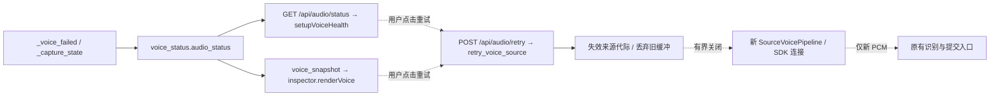
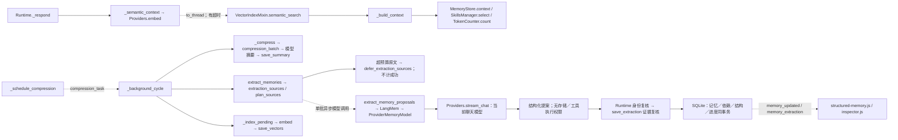
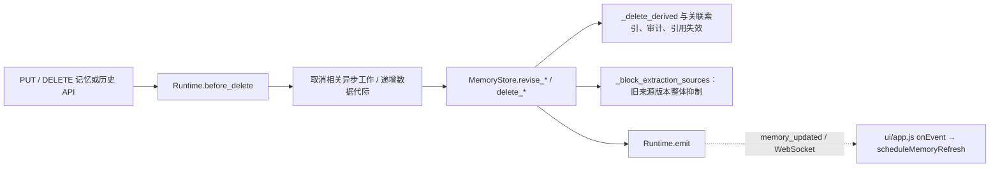
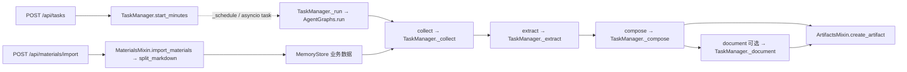
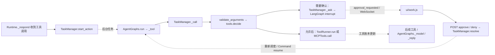

# 功能与代码导航

更新日期：2026-10-24。适用于包含 v0.6 结构化记忆的当前源码实现；构建、验证与发布状态以 [project-status.md](project-status.md) 为准。

遇到问题时先按下表找到功能入口，再沿调用链找实现与事件。这里记录稳定的文件路径和符号，不维护易漂移的行号，也不逐个列出辅助函数。架构与边界见 [architecture.md](architecture.md)，后续能力见 [roadmap.md](roadmap.md)。

## 核心目录

下列为职责树，省略依赖、生成物、运行数据和部分同类文件；不是全部文件清单。

```text
GreatSage/
├─ AGENTS.md / agent.md              自动读取入口、项目约束与开发方法
├─ README.md                         使用入口与文档入口
├─ desktop/
│  ├─ main.cjs                       Electron 生命周期、窗口、托盘、后端进程
│  └─ preload.cjs                    受限桌面桥接
├─ ui/
│  ├─ index.html / styles.css        控制台布局与样式
│  ├─ app.js / client.js             页面协调、播放、HTTP / WebSocket 客户端
│  ├─ memory.js / audit.js           历史、记忆冲突、索引及审计
│  ├─ structured-memory.js           提取设置、候选、实体关系与原文证据
│  ├─ work.js / mcp.js               资料、任务、产物、审批与 MCP 配置
│  ├─ inspector.js                   运行监控
│  ├─ voice.js                       音源状态、故障说明与恢复操作
│  └─ pet.html / pet.js / pet.css    桌宠
├─ greatsage/
│  ├─ __main__.py / server.py        本地服务入口、认证与路由
│  ├─ runtime.py                    前台交互与后台任务协调
│  ├─ audio.py / winloopback.py      Windows 采集
│  ├─ segmentation.py / echo.py     分段与回声抑制措施
│  ├─ voice_pipeline.py             Pipecat 分音源生命周期、背压及固定身份
│  ├─ voice_turns.py                本地话轮记录、稳定身份与有界待确认队列
│  ├─ voice_status.py               首页与监控共享的音源元数据／恢复动作
│  ├─ streaming_asr.py              可选 Deepgram 官方 SDK 薄适配、连接探针
│  ├─ providers.py / chat_models.py 模型、ASR、TTS、嵌入适配
│  ├─ settings.py / skills.py       配置、凭据与只读 Skill
│  ├─ memory.py / semantic.py       记忆持久化、来源关系、向量检索
│  ├─ structured_memory.py          结构化记忆、实体分组、提取进度与抑制
│  ├─ memory_extraction.py          LangMem schema 与现有模型传输薄适配
│  ├─ budget.py / background.py     上下文预算与后台退避
│  ├─ decisions.py                  回应策略
│  ├─ materials.py / artifacts.py   资料、引用与版本化产物
│  ├─ workflows.py / tasks.py       纪要规则与任务执行协调
│  ├─ task_store.py                 任务、步骤与工具账本持久化
│  ├─ agent_graph.py                LangGraph 图、检查点与恢复
│  ├─ tools.py / mcp_tools.py       权限、本地工具与 MCP SDK 适配
│  ├─ audit.py / inspector.py       请求快照与监控聚合
│  └─ evaluation.py                 评测辅助逻辑
├─ tests/                           按模块组织的回归用例
├─ evals/                           固定评测样本与可公开的结果摘要
├─ scripts/                         启动、构建、评测与冒烟脚本
├─ docs/                            架构、需求、路线图、验证与开发记录
├─ .github/workflows/               CI
└─ pyproject.toml / package.json / greatsage-backend.spec
                                   Python、Electron 依赖及打包配置
```

## 按功能找文件与符号

路径均相对仓库根目录。除特别注明外，API 处理函数在 [server.py](../greatsage/server.py) 的 `create_app()` 内定义。测试列是定位已有覆盖的起点，**不是要求每次全部运行，也不表示已经完成真实环境验收**。

| 用户功能 / 问题 | UI / API 入口 | 主要实现文件与符号 | 相关验证位置 |
| --- | --- | --- | --- |
| 启动、连接失败、窗口与托盘 | [desktop/main.cjs](../desktop/main.cjs): `startBackend`, `makeMainWindow`, `registerBridge` | [greatsage/__main__.py](../greatsage/__main__.py): `main` → `server.create_app`；[ui/client.js](../ui/client.js): `SageClient.initialize`, `connect` | [scripts/smoke_desktop.cjs](../scripts/smoke_desktop.cjs), [tests/test_server.py](../tests/test_server.py) |
| 桌面退出、父进程消失与后端收尾 | [desktop/main.cjs](../desktop/main.cjs): `stopBackend`，私有 stdin 管道 | [greatsage/__main__.py](../greatsage/__main__.py): `_watch_desktop_pipe` / `--shutdown-stdin` → uvicorn 正常关闭 → `Runtime.close` | [scripts/test_desktop_shutdown.cjs](../scripts/test_desktop_shutdown.cjs), [scripts/smoke_shutdown.py](../scripts/smoke_shutdown.py) |
| 设置、密钥、模型切换 | [ui/app.js](../ui/app.js): `saveSettings`, `saveQuickSettings`；`PUT /api/settings` | [greatsage/settings.py](../greatsage/settings.py): `SettingsStore.update`, `provider`, `read_env`；服务端 `update_settings` | [test_settings.py](../tests/test_settings.py), [test_server.py](../tests/test_server.py) |
| 音源列表、开始 / 停止监听 | [ui/app.js](../ui/app.js): `loadSources`；`GET /api/audio/sources`, `POST /api/listening` | [runtime.py](../greatsage/runtime.py): `Runtime.set_listening`, `_enqueue`, `_audio_consumer`；[audio.py](../greatsage/audio.py): `AudioCaptureManager.sources`, `start`, `stop`；进程采集再看 [winloopback.py](../greatsage/winloopback.py) | [test_audio.py](../tests/test_audio.py), [test_runtime.py](../tests/test_runtime.py) |
| 单音源故障与识别重试 | [ui/voice.js](../ui/voice.js): `setupVoiceHealth`, `describeVoiceSource`；`GET /api/audio/status`, `POST /api/audio/retry` | [voice_status.py](../greatsage/voice_status.py): `audio_status`；[runtime.py](../greatsage/runtime.py): `Runtime.retry_voice_source`, `_capture_state`, `_retire_voice_source` | [test_voice_recovery.py](../tests/test_voice_recovery.py), [scripts/smoke_desktop.cjs](../scripts/smoke_desktop.cjs) |
| 连续语音、待确认话轮与最终转写 | `transcript`、`speech_start`、`voice_turn` 事件；[ui/app.js](../ui/app.js): `addTranscript`, `markUnfinishedTranscripts`, `resetTranscripts` | [voice_turns.py](../greatsage/voice_turns.py): `make_turn`, `records`, `activity`, `turn_id`；[voice_pipeline.py](../greatsage/voice_pipeline.py): `_SegmentProcessor.process_frame`, `_audio`；[runtime.py](../greatsage/runtime.py): `_handle_segment`, `voice_activity`；转写回调 `_streaming_transcript` → `_flush_streaming_turn` → `_commit_streaming_turn` → `_accept_transcript` | [test_voice_turns.py](../tests/test_voice_turns.py), [test_voice_runtime.py](../tests/test_voice_runtime.py), [test_streaming_commit.py](../tests/test_streaming_commit.py), [test_voice_pipeline.py](../tests/test_voice_pipeline.py), [scripts/smoke_desktop.cjs](../scripts/smoke_desktop.cjs) |
| 继续说话时延后回应 | `voice_turn`、`decision` 事件；首页音源状态 | [runtime.py](../greatsage/runtime.py): `_route_voice_message`, `_voice_busy`, `_defer_voice_message`, `_flush_pending_voice` → `_route_message`；已确认原文先存储，延后的回应触发只保留最新一轮 | [test_voice_turns.py](../tests/test_voice_turns.py), [test_streaming_commit.py](../tests/test_streaming_commit.py) |
| 识别、断句、打断与回声 | `POST /api/interrupt`；`transcript`, `speech_start`, `interrupt` 事件 | [segmentation.py](../greatsage/segmentation.py): `Segmenter.feed`；[runtime.py](../greatsage/runtime.py): `_transcribe`, `interrupt`；[providers.py](../greatsage/providers.py): `Providers.transcribe`；[echo.py](../greatsage/echo.py) | [test_segmentation.py](../tests/test_segmentation.py), [test_echo.py](../tests/test_echo.py), [test_runtime.py](../tests/test_runtime.py) |
| 文字回答、旁听与主动回应 | [ui/app.js](../ui/app.js) 的消息提交监听器；`POST /api/chat` | [runtime.py](../greatsage/runtime.py): `chat`, `_route_message`, `_should_reply`, `_consider_proactive`, `submit_message`, `_respond`；策略辅助在 [decisions.py](../greatsage/decisions.py) | [test_runtime.py](../tests/test_runtime.py), [test_runtime_v02.py](../tests/test_runtime_v02.py) |
| API / Ollama 流式聊天 | `POST /api/providers/test`；服务端 `test_provider` | [providers.py](../greatsage/providers.py): `Providers.stream_chat` → [chat_models.py](../greatsage/chat_models.py): `stream_chat`；`MeteredChatOpenAI`, `NamedToolChatOllama` | [test_providers.py](../tests/test_providers.py), [test_probe_providers.py](../tests/test_probe_providers.py) |
| 全局指令与现成 Skills | [ui/app.js](../ui/app.js): `refreshSkills`；`/api/skills` 系列接口 | [skills.py](../greatsage/skills.py): `SkillsManager.import_path`, `select`, `set_enabled`；[runtime.py](../greatsage/runtime.py): `_build_context` | [test_skills.py](../tests/test_skills.py), [test_runtime.py](../tests/test_runtime.py) |
| 语音语言、音色与播放 | [ui/app.js](../ui/app.js): `AudioPlayer.enqueue`, `next`, `stop`, `notify`；`POST /api/playback` | [runtime.py](../greatsage/runtime.py): `_speak_worker`, `playback`，校验每句身份／顺序与一次性停止回执；[providers.py](../greatsage/providers.py): `synthesize`, `voices` | [test_providers.py](../tests/test_providers.py), [test_runtime.py](../tests/test_runtime.py), [test_audio_player.py](../tests/test_audio_player.py), [scripts/smoke_desktop.cjs](../scripts/smoke_desktop.cjs) |
| 新会话与历史浏览 | [ui/app.js](../ui/app.js) 的新会话监听器；[ui/memory.js](../ui/memory.js): `setupMemoryPanel`；`/api/sessions`, `/api/history/page` | [runtime.py](../greatsage/runtime.py): `reset_session`；[memory.py](../greatsage/memory.py): `new_session`, `sessions`, `history_page` | [test_memory_v02.py](../tests/test_memory_v02.py), [test_runtime.py](../tests/test_runtime.py), [test_server.py](../tests/test_server.py) |
| 显式长期记忆与冲突 | [ui/app.js](../ui/app.js): `renderMemories`；[ui/memory.js](../ui/memory.js): `setupMemoryPanel`；`/api/memories`, `/api/memory/conflicts` | [runtime.py](../greatsage/runtime.py): `_remember_explicit`, `add_memory_checked`；[memory.py](../greatsage/memory.py): `add_memory`, `conflicts`, `resolve_conflict` | [test_memory_v02.py](../tests/test_memory_v02.py), [test_runtime_v02.py](../tests/test_runtime_v02.py) |
| 自动提取设置、手动提取与状态 | [ui/structured-memory.js](../ui/structured-memory.js): `setupStructuredMemory`；`PUT /api/settings`、`GET/POST /api/memory/extraction` | [runtime.py](../greatsage/runtime.py): `request_memory_extraction`, `memory_extraction_status`, `_background_cycle`, `extract_memories`, `pause_background`；[settings.py](../greatsage/settings.py): `_validate` | [test_memory_runtime.py](../tests/test_memory_runtime.py), [test_settings.py](../tests/test_settings.py), [test_server.py](../tests/test_server.py) |
| LangMem 提取与原文证据校验 | 后台 `Runtime.extract_memories`；[ui/memory.js](../ui/memory.js): `showRecord` → [ui/structured-memory.js](../ui/structured-memory.js): `appendStructuredEvidence`；`GET /api/records/{id}` | [memory_extraction.py](../greatsage/memory_extraction.py): `MemoryFact`, `NoMemory`, `plan_sources`, `extraction_budget_version`, `ProviderMemoryModel._agenerate`, `extract_memory_proposals`；[structured_memory.py](../greatsage/structured_memory.py): `extraction_sources`, `defer_extraction_sources`, `_validate_extraction_sources`, `_validate_extraction_item`, `save_extraction` | [test_memory_extraction.py](../tests/test_memory_extraction.py), [test_structured_memory.py](../tests/test_structured_memory.py), [test_memory_runtime.py](../tests/test_memory_runtime.py) |
| 提取候选确认、拒绝与冲突 | `GET /api/memory/candidates`、`POST /api/memory/candidates/{id}/resolve`；冲突复用 `/api/memory/conflicts/{id}` | [structured_memory.py](../greatsage/structured_memory.py): `memory_candidates_list`, `resolve_memory_candidate`, `_structured_conflicts`；[ui/structured-memory.js](../ui/structured-memory.js): `renderCandidates`, `resolveCandidate`；[ui/memory.js](../ui/memory.js): `refreshConflicts` | [test_structured_memory.py](../tests/test_structured_memory.py), [test_server.py](../tests/test_server.py), [scripts/smoke_desktop.cjs](../scripts/smoke_desktop.cjs) |
| 实体、关系与证据浏览 | `GET /api/memory/entities?q=`、`GET /api/memory/entities/{id}`；[ui/structured-memory.js](../ui/structured-memory.js): `refreshEntities`, `showEntity` | [structured_memory.py](../greatsage/structured_memory.py): `_entity_id`, `_entity_records`, `memory_entities`, `memory_entity`；修改／删除跳回 `renderMemories` 既有入口 | [test_structured_memory.py](../tests/test_structured_memory.py), [test_server.py](../tests/test_server.py), [scripts/smoke_desktop.cjs](../scripts/smoke_desktop.cjs) |
| 历史检索与回答上下文 | [ui/app.js](../ui/app.js): `scheduleHistorySearch`；`GET /api/memory/search` | 手动搜索：[memory.py](../greatsage/memory.py): `search`；回答检索：[runtime.py](../greatsage/runtime.py): `_semantic_context`, `_build_context` → `MemoryStore.context`；[semantic.py](../greatsage/semantic.py): `semantic_search`, `fuse`；[budget.py](../greatsage/budget.py): `TokenCounter.count` | [test_memory.py](../tests/test_memory.py), [test_memory_v02.py](../tests/test_memory_v02.py), [test_semantic.py](../tests/test_semantic.py) |
| 摘要压缩、向量索引、后台重试 | [ui/memory.js](../ui/memory.js): `setupMemoryPanel`；`/api/memory/index`, `/api/background/retry` | [runtime.py](../greatsage/runtime.py): `_schedule_compression`, `_background_cycle`, `_compress`, `_index_pending`；[memory.py](../greatsage/memory.py): `compression_batch`, `save_summary`；[background.py](../greatsage/background.py): `BackgroundState` | [test_runtime_v02.py](../tests/test_runtime_v02.py), [test_memory_v02.py](../tests/test_memory_v02.py), [test_semantic.py](../tests/test_semantic.py) |
| 纠正 / 删除内容和派生数据 | [ui/app.js](../ui/app.js): `renderMemories`, `renderHistory`；`PUT/DELETE /api/memories/{record_id}`, `/api/history/{record_id}` | [runtime.py](../greatsage/runtime.py): `before_delete`；[memory.py](../greatsage/memory.py): `revise_message`, `revise_memory`, `delete_message`, `delete_memory`, `_delete_derived`；关联清理见 [audit.py](../greatsage/audit.py), [artifacts.py](../greatsage/artifacts.py) | [test_memory.py](../tests/test_memory.py), [test_memory_v02.py](../tests/test_memory_v02.py), [test_runtime_v02.py](../tests/test_runtime_v02.py), [test_audit.py](../tests/test_audit.py) |
| 导入 / 更新 / 检索资料 | [ui/work.js](../ui/work.js): `setupWork`；`/api/materials` 系列接口 | [materials.py](../greatsage/materials.py): `collect_markdown`, `split_markdown`, `MaterialsMixin.import_materials`, `rescan_materials`, `search_chunks` | [test_materials.py](../tests/test_materials.py), [test_server.py](../tests/test_server.py) |
| 生成纪要、待办、文档 | [ui/work.js](../ui/work.js): `setupWork`；`POST /api/tasks` | [tasks.py](../greatsage/tasks.py): `TaskManager.start_minutes`, `_collect`, `_extract`, `_compose`, `_document`；[agent_graph.py](../greatsage/agent_graph.py): `AgentGraphs._minutes`；抽取与渲染规则在 [workflows.py](../greatsage/workflows.py) | [test_tasks.py](../tests/test_tasks.py), [scripts/evaluate_tasks.py](../scripts/evaluate_tasks.py) |
| 编辑 / 重生成 / 导出产物 | [ui/work.js](../ui/work.js): `setupWork`；`/api/artifacts` 系列接口，`PUT /api/todos/{todo_id}` | [artifacts.py](../greatsage/artifacts.py): `ArtifactsMixin.add_artifact_version`, `update_todo`, `export_markdown`；[tasks.py](../greatsage/tasks.py): `TaskManager.regenerate` | [test_tasks.py](../tests/test_tasks.py), [test_materials.py](../tests/test_materials.py), [test_server.py](../tests/test_server.py) |
| 任务存储与工具账本 | 内部持久化入口，由 `MemoryStore` 组合；任务详情经 `GET /api/tasks/{task_id}` 查看 | [task_store.py](../greatsage/task_store.py): `TaskStoreMixin.create_task`, `update_step`, `recover_tasks`, `add_tool_call`, `tool_call_by_key`, `update_tool_call`；执行协调仍在 [tasks.py](../greatsage/tasks.py) | [test_tasks.py](../tests/test_tasks.py), [test_memory.py](../tests/test_memory.py) |
| 图任务状态、取消与恢复 | [ui/work.js](../ui/work.js): `setupWork`；`POST /api/tasks/{task_id}/cancel`, `/resume` | [tasks.py](../greatsage/tasks.py): `TaskManager._schedule`, `_run`, `cancel`, `resume`, `recover`；[agent_graph.py](../greatsage/agent_graph.py): `AgentGraphs.run`, `inspect` | [test_tasks.py](../tests/test_tasks.py), [scripts/smoke_backend.py](../scripts/smoke_backend.py) |
| 工具执行、审批与撤销 | [ui/work.js](../ui/work.js): `setupWork`；`/api/tool-calls/{call_id}/approve`, `/deny`, `/undo` | [tasks.py](../greatsage/tasks.py): `start_action`, `_call`, `_ask`, `resolve`, `undo`；[tools.py](../greatsage/tools.py): `validate_arguments`, `decide`, `Workspace.resolve`, `ToolRunner.run` | [test_tools.py](../tests/test_tools.py), [test_tasks.py](../tests/test_tasks.py), [test_server.py](../tests/test_server.py) |
| MCP 配置、发现与调用 | [ui/mcp.js](../ui/mcp.js): `setupMCP`；`/api/mcp/servers`, `/{server_id}/discover`, `/api/mcp/disconnect` | [mcp_tools.py](../greatsage/mcp_tools.py): `MCPTools.discover`, `call`, `sdk_session`；执行仍从 `TaskManager._call` 进入 | [test_mcp.py](../tests/test_mcp.py), [test_tasks.py](../tests/test_tasks.py), [scripts/smoke_backend.py](../scripts/smoke_backend.py) |
| 动态日志、请求审计、运行监控 | [ui/app.js](../ui/app.js): `onEvent`, `renderEvents`；[ui/audit.js](../ui/audit.js): `setupAudit` / [ui/inspector.js](../ui/inspector.js): `setupInspector`；`/api/events`, `/api/audit`, `/api/inspector` | [runtime.py](../greatsage/runtime.py): `emit`, `snapshot_request`；[audit.py](../greatsage/audit.py): `AuditMixin.save_snapshot`, `snapshot`；[inspector.py](../greatsage/inspector.py): `inspect_runtime` | [test_audit.py](../tests/test_audit.py), [test_server.py](../tests/test_server.py), [scripts/smoke_desktop.cjs](../scripts/smoke_desktop.cjs) |
| 桌宠摸摸、气泡、状态与任务提示 | [ui/pet.js](../ui/pet.js): `setMessage`, `setState`, `taskMessage` 及触摸事件监听器 | [desktop/main.cjs](../desktop/main.cjs): `showPet`, `hidePet`；[ui/pet.html](../ui/pet.html), [pet.css](../ui/pet.css)；接收 `SageClient` 推送事件 | [scripts/smoke_desktop.cjs](../scripts/smoke_desktop.cjs) |
| 构建与分发 | [package.json](../package.json): `package` / `build.nsis`；[scripts/build.ps1](../scripts/build.ps1): `-Target dir/zip/nsis` | [greatsage-backend.spec](../greatsage-backend.spec), [scripts/backend_entry.py](../scripts/backend_entry.py)；PyInstaller 后端 → electron-builder 目录／ZIP／NSIS | [scripts/smoke_backend.py](../scripts/smoke_backend.py)；安装配置已实现，实际验收见各 `validation-*.md` |

测试表内省略目录的 `test_*.py` 均在 `tests/`。`MemoryStore` 继承 `StructuredMemoryMixin`、`VectorIndexMixin`、`AuditMixin`、`MaterialsMixin`、`ArtifactsMixin`、`TaskStoreMixin`：例如 `runtime.memory.save_extraction()` 位于 `structured_memory.py`，`create_artifact()` 位于 `artifacts.py`，任务账本实现位于 `task_store.py`。这些存储入口不导入 LangMem 或任务执行器；模型提取经 Runtime 按需加载。

本轮结构整理将 `ui/v02.js` / `setupV02` 改为按职责命名的 `ui/memory.js` / `setupMemoryPanel`，并把 `TaskStoreMixin` 从 `tasks.py` 提取到 `task_store.py`（原模块保留兼容导出）；不改变业务语义。历史验证文件名保留，查旧提交时注意名称差异。

## 主调用链与异步边界

图中实线表示主要调用 / 数据传递；虚线及标签标明线程、任务、队列或事件边界。省略错误处理和旁支，改动前仍须查看调用点。

### 1. 语音 / 文字 → 回答 → 播放

```mermaid
flowchart LR
    C["AudioCaptureManager.start"] -. "采集线程回调 / call_soon_threadsafe" .-> Q["Runtime._enqueue"]
    Q -. "audio_queue" .-> A["Runtime._audio_consumer → SourceVoicePipeline.feed"]
    A -. "VAD / _handle_segment" .-> T["Runtime._transcribe → Providers.transcribe"]
    A -. "流式帧" .-> STT["Deepgram → _streaming_transcript → _flush_streaming_turn"]
    T --> Accept["Runtime._accept_transcript"]
    STT -. "逐轮串行提交" .-> Commit["Runtime._commit_streaming_turn"]
    Commit --> Accept
    Accept --> Gate["Runtime._route_voice_message → _defer_voice_message"]
    Gate -. "仍在说话 / 待确认：延后触发" .-> Pending["pending_voice → _flush_pending_voice"]
    Gate --> R["Runtime._route_message"]
    Pending --> R
    U["POST /api/chat → Runtime.chat"] --> S["Runtime.submit_message"]
    R --> S
    S -. "reply_task" .-> O["Runtime._respond"]
    O --> L["Providers.stream_chat → chat_models.stream_chat"]
    L --> O
    O -. "response_delta / WebSocket" .-> UI["ui/app.js onEvent"]
    O -. "speech_queue" .-> V["Runtime._speak_worker → Providers.synthesize"]
    V -. "audio 事件" .-> P["AudioPlayer.enqueue → next"]
    P --> F["POST /api/playback → Runtime.playback"]
```



旁听 / 主动模式还经 `_should_reply` / `_consider_proactive` 判断；桌面声音属于观察输入。语音统一经 Pipecat 管线；原服务保留分段快照，Deepgram 可选原生流式。实际起播由客户端回执衡量，不能把音频生成完成当成已经播放。

`transcript.turn_id` 固定到原话轮，迟到的上一轮 final 更新原行，不覆盖下一轮临时文字。`voice_turn` 只携带身份、`speech_phase` 和 `pending_turns` 元数据；首页与监控从 `voice_status.audio_status` 刷新共享快照。流式 `pending_turns` 统计已本地结束但仍在确认或提交的话轮，不含仍在说话的当前轮次。停止或失败后的临时文字标为“未完成，未提交”，会话切换清空实时列表。



只有采集仍活跃的识别故障可走单源重试；设备停止与配置问题分别导向音源和识别设置。旧连接的回调、错误及排队音频不能改变重试后的状态。

### 2. 回答上下文与后台记忆更新



前台语音 / 回复会让后台让出；语义检索失败可回退词法。提取独立开关默认关闭、策略默认“大部分确认”，一次至多 8 条用户原文、24 项提案；`POST /api/memory/extraction` 只安排当前会话的一批工作。来源版本、向量指纹和证据复核由应用维护，不能因替换模型库而省略。三档生效与识别边界见 [memory-design.md](memory-design.md)，确认范围见 [v0.6-plan.md](v0.6-plan.md)。

### 3. 纠正 / 删除 → 阻止旧结果回写



具体清理顺序见 `before_delete`、`_delete_record` 和 `_delete_derived`。拒绝提取候选也走同一删除边界；`_block_extraction_sources` 持久保留来源 ID／哈希以阻止旧来源换一种说法再生。会话、音频与数据删除使用不同代际；调试迟到结果时同时检查 `generation`、`epoch`、`data_epoch`、`capture_generation`，提取还核对 `memory_extraction_epoch`、会话 ID 与设置版本，不只依赖任务取消。

### 4. 资料 → 图任务 → 产物



图只持久化控制状态；来源正文、步骤结果与产物仍在业务数据库。`TaskManager._step` 负责步骤状态，`changed` 推送进度；不能把 checkpoint 当成业务数据或工具执行账本。

### 5. 工具 → 审批中断 → 恢复



图为分支示意：需要确认的调用只有恢复并核对批准记录后才进入执行。MCP 每次调用必须点击；本地工具在线程执行。执行结果未知时停止后续工具，恢复任务也不自动重放未知操作。

## 快速定位与追溯

安装验收：[scripts/smoke_installer.ps1](../scripts/smoke_installer.ps1) 的 `Invoke-Installer`／`Invoke-OwnedUninstall`、`Assert-DataHashes` 及人工退出节点；运行前查看脚本头部边界。`desktop/main.cjs` 在 ready 前处理显式数据目录隔离，`stopBackend` 与后端 `_watch_desktop_pipe` 完成正常退出。

冻结语音排障：`python -m greatsage --check-voice-runtime` 或包内后端同名参数 → [diagnostics.py](../greatsage/diagnostics.py) 的 `check_voice_runtime`；不连接服务、不启用设备，检查 SDK 懒加载与合成静音管线。新增依赖时同步 [greatsage-backend.spec](../greatsage-backend.spec)、[hook-deepgram.py](../scripts/hooks/hook-deepgram.py) 和[许可记录](third-party.md)。

语音监控：[inspector.py](../greatsage/inspector.py) 的 `voice_snapshot` → `inspect_runtime` → [ui/inspector.js](../ui/inspector.js) 的 `renderVoice`。修改耗时字段或错误码时同步 `_VOICE_METRICS`／`_VOICE_ERRORS` 白名单；定向检查为 [test_voice_inspector.py](../tests/test_voice_inspector.py)。

语音管线入口：[voice_pipeline.py](../greatsage/voice_pipeline.py) 的 `VoiceIdentity`、`SourceVoicePipeline.start/feed/drain/close`；`_SegmentProcessor` 先传开始事件、后传 PCM、最后传结束事件，`_ResultProcessor` 仅回调固定身份和白名单端点信息。定向覆盖见 [test_voice_pipeline.py](../tests/test_voice_pipeline.py)；Runtime 接入状态见开发日志。

流式服务配置：[settings.py](../greatsage/settings.py) 的 `_validate`／`SettingsStore.update` → [streaming_asr.py](../greatsage/streaming_asr.py) 的 `_configuration`；实例化由 `create_streaming_asr` 完成，`probe_streaming_connection` 负责无音频连接检查。界面入口为“设置 → 语音识别 → Deepgram 流式识别”，对应 `setupProviderExtras` 与 `/api/providers/test`；[test_streaming_asr.py](../tests/test_streaming_asr.py) 覆盖单连接、空 Finalize、错误／取消和无正文日志。

真实模型／MCP 的有界验收入口是 [scripts/probe_agent_tools.py](../scripts/probe_agent_tools.py)：`run_case()` 复用 `Runtime.chat`、`TaskManager.resolve` 和工具账本；`MeasuredProviders.stream_chat()` 记录请求次数与用量。显式选择服务后才调用，公开结果见 [evals/results-v0.4.json](../evals/results-v0.4.json)。它不替代故障回归或真实鼠标／语音验收。

在仓库根目录使用以下只读搜索；先缩小文件范围，不必打印整个仓库：

```powershell
# 从界面路径找服务端处理函数；从函数定义找所有调用点。
rg -n -F '/api/inspector' ui greatsage tests
rg -n '^\s*(async )?def (_respond|before_delete)\(' greatsage/runtime.py
rg -n -F 'before_delete(' greatsage tests
# 从屏幕上的事件 / 错误提示反查生产者与消费者。
rg -n -F 'approval_requested' greatsage ui tests
# 查看某段代码与某文件的演变。
git log -S 'ToolOutcomeUnknown' -- greatsage/tasks.py
git blame -L '/async def _call/,+25' -- greatsage/tasks.py
```

一次问题优先关联 `trace_id` → `task_id` / `call_id` → 请求快照与事件；快照全文默认关闭，监控页不等于完整请求档案。排查源码时不打印运行目录中的密钥、录音或私人会话。结论、原因、修复和验证边界写入 [development-log.md](development-log.md)，架构取舍回链到对应设计文档。

当前尚未实现：Deep Agents / 多 Agent、旧会话继续交互、MCP stdio / OAuth。LangMem 提取、候选和实体列表已接入；实体按精确名称／类型分组，不承担同名消歧。Pipecat 和 NSIS 配置已实现，真实语音与安装验收状态见当前验证文档；新增目录不能被当成质量和性能已经验收的证据。

### v0.5 音源、话轮与取消链

```mermaid
flowchart LR
    Capture[Windows capture] --> Queue[Runtime._enqueue / _audio_consumer]
    Queue --> Pipe[SourceVoicePipeline.feed]
    Pipe --> Segment[Runtime._handle_segment]
    Segment --> Batch[Providers.transcribe]
    Pipe --> STT[Deepgram 官方流式服务]
    Segment --> Records[voice_turns.make_turn / records]
    STT --> Turn[Runtime._streaming_transcript / _flush_streaming_turn]
    Records --> Turn
    Batch --> Accept[Runtime._accept_transcript]
    Turn -. 逐轮串行提交 .-> Commit[Runtime._commit_streaming_turn]
    Commit --> Accept
    Accept --> History[记忆原文 / 显式记忆]
    Accept --> Gate[_route_voice_message / _defer_voice_message]
    Gate -. 仍在说话或等待确认 .-> Pending[pending_voice / _flush_pending_voice]
    Gate --> Route[_route_message / 原权限入口]
    Pending --> Route
    Cancel[停听 / 删除 / 会话切换] --> Invalidate[_invalidate_audio]
    Invalidate --> Close[SourceVoicePipeline.close]
```



流式 PCM 先按 30 ms 切分；`_SegmentProcessor._audio` 维护含静音的已提交 PCM 时间轴，`_streaming_transcript` 按区间匹配最早未确认的话轮。队列允许四个较早的待确认话轮加当前轮次；只有明确歧义、队列满、丢帧／积压或本地结束后 15 秒仍未确认等故障才停源，下一次开口本身不是故障。Deepgram 时间戳并非声卡样本级精度，Finalize ACK 也不保证返回；`_flush_streaming_turn` 仅按远端端点或完整稳定区间覆盖保守放行。

丢帧／积压排障从 `_voice_failed`、`_retire_voice_source` 和 `voice_errors` 开始；端点排障看 `_streaming_segment`／`_streaming_finalize_timeout`；抢话排障看 `_voice_busy`／`_defer_voice_message`。`_voice_current` 与提交阶段 `current()` 核验固定身份；后台任务不能通过旧身份写回。相关用例从 [test_voice_runtime.py](../tests/test_voice_runtime.py) 与 [test_streaming_commit.py](../tests/test_streaming_commit.py) 定位；真实连续语音与 Deepgram 验证边界见 [validation-v0.5.md](validation-v0.5.md)。
