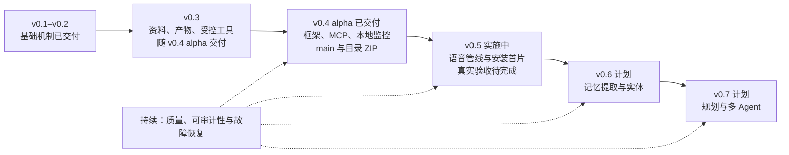

# GreatSage 路线图

更新日期：2026-10-21。**v0.5 首轮实现已进入集成，阶段验收尚未完成**；最近发布仍为 0.4.0-alpha.1。当前重点是 Pipecat、可选流式识别、播放计时与 Windows 安装，方案见[v0.5 计划](v0.5-plan.md)，证据见[v0.5 验证](validation-v0.5.md)。版本号表示开发顺序，不承诺日期。

| 阶段 | 状态 | 目标 |
| --- | --- | --- |
| v0.1 alpha | 已实现基础机制，留有真实场景验收项 | Windows 桌面语音秘书、三种回应预设、云端／本地模型、记忆、日志与桌宠 |
| v0.2 alpha | 六项机制已交付，质量与性能仍在收敛 | 回应质量、可重复评测、混合检索、分层记忆、请求审计与后台恢复 |
| 当前稳定化 | 进行中 | 真实设备、自然会话、响应时间、长时间运行与桌面分发验证 |
| v0.3 | 随 v0.4 alpha 交付；真实场景验收继续保留 | 资料到结构化产物、受控工具与任务恢复；MCP 转入 v0.4，安装验收转入 v0.5 |
| v0.4 alpha | 已从 main 交付 | LangChain 模型、LangGraph 编排与审批、MCP HTTP、本地监控和目录 ZIP；见 [实施方案](v0.4-plan.md)和[开发日志](development-log.md) |
| v0.5 | 首轮实现完成，集成与真实验收推进中 | Pipecat、可选 Deepgram、播放回执、语音监控、NSIS；真实质量／设备／安装／长运行待验收 |
| v0.6–v0.7 | 已确认方向、尚未实现 | LangMem／实体记忆、Deep Agents／多 Agent |

下面表示已确认的阶段顺序，不表示未来能力已经实现，也不承诺日期：

2026-10-20 补充工程维护约定：按[开发方法](../agent.md)随功能维护[代码导航](code-map.md)、架构与[经验记录](lessons-learned.md)。结构整理按职责小步实施：当前已分离任务存储、统一记忆界面命名；后续在语音迁移时评估提取音频会话协调，在记忆迁移时评估提取上下文／后台任务，新增界面时按功能拆控制器。这些是实现组织方式，不增加版本功能承诺或全仓重写阶段。

## 已交付：v0.1 与 v0.2

v0.1 建立文字及人的语音输入、麦克风与一个系统／进程桌面音源、全局 Prompt 和三种回应预设；支持 OpenRouter／兼容 API、Ollama、流式文字、分句语音、打断、只读 Skill 引用、显式记忆、动态日志及 Q 版桌宠。可新建会话并浏览旧原文；历史仍可用于跨会话检索。它不支持返回旧会话继续执行任务。

v0.2 的六项机制已经交付：

1. 结构化旁听判断、主动观察去重、VAD 句首修复、逐帧参考回声与音频缺口处理。
2. 固定回应、记忆、公共真人朗读、完整管线和 32 会话摘要评测，可保存报告并比较版本。
3. 适用的 tokenizer、保守预算回退、API／Ollama 嵌入及词法／语义混合检索。
4. 显式记忆冲突待确认、替换／丢弃／共存、三级摘要、旧会话续压缩、来源详情与分页。
5. 默认只存元数据的配置／Skill／请求快照，显式正文归档与导出，以及来源删除后的失效处理。
6. 有限后台批次、前台优先、失败退避、重启续建、音源故障恢复与用量审计。

以上是机制完成状态，不代表所有用户场景都通过质量验收。[验证记录](validation-v0.2.md)保留固定集成绩、测试覆盖及未达到的目标；[历史方案](v0.2-plan.md)保留当时确定的范围。

## 当前稳定化：功能完善与必要验证

2026-10-22 用户确认功能优先，不强行追求预设指标。先补 v0.5 的单音源识别恢复、故障提示和操作流程；延迟目标作为优化参考，保留实测差距与未测项。权限、来源隔离、数据保留及发布对象的必要检查继续执行。依赖额外凭据、设备或人工安装的验证单独跟踪，不作为所有功能的前置任务。

- **真实输入和准确性**：在真实麦克风、系统整体、单一程序及同时监听下测试来源身份、设备切换／退出、噪声、扬声器回流与重叠说话；扩充人名、数字、术语、中英混合和自然对话样本；分别记录 API、本地及混合模型组合的能力与错误。
- **响应与成本**：继续测量语音结束到有效首字、客户端实际起播及打断停止。当前三轮公共录音的首字 P50 约 3.14 秒、音频就绪 P50 约 4.90 秒，尚未达到此前确认的 1–2 秒首字和 2–3 秒实际起播目标。评估原生流式 ASR、轮次判断和完整 AEC；记录远端费用及持续运行的整机 CPU、内存、磁盘和本地模型资源。
- **持久化与规模**：测试更大历史库的检索、复杂事实关系保留、冲突漏检、修正与删除后的派生数据失效，以及切换会话和多次取消时迟到结果的隔离。
- **桌面交付**：改进解释性错误、录音回放、安装体验和 API 模式的依赖体积；验证整天运行、退出清理、全新 Windows 环境的安装／升级／卸载及数据保留。来源定位、摘要查看和旧原文分页已交付，仍需真实操作反馈。当前发布 Windows x64 目录 ZIP，尚未发布安装器或受信任发行签名，跨机器兼容仍待验收。

曾讨论的“首页可跳过首配清单”方案已搁置，未列入当前交付承诺。定时提醒也不在现有版本内；下述待办首先指可编辑的任务清单。

## v0.3：资料到产物的任务主线

用户确认 v0.3 同时覆盖“资料检索→纪要／待办／文档产出”和受控工具执行。2026-09-30 确认了资料和产物格式（`.md`）、授权方式（参照主流前沿 agent，默认点击确认，语音确认需先接受警告）和进度显示方式（控制台显示详情，桌宠只显示简化版），设计见 [v0.3 开发方案](v0.3-plan.md)。各项按依赖顺序排列：

1. **资料与引用（已实现 `.md`）**。从会话、记忆、摘要和导入的 Markdown 资料中检索。资料按标题和段落分块，记录行号和内容版本；重新扫描发现修改后生成新版本，旧引用失效。原始资料和模型推断分开呈现。PDF、Word、网页等格式留待后续。
2. **结构化产物（已实现）**。首个完整任务是“会话原文与资料→带出处纪要→可编辑待办→文档草稿”。模型抽取结构化条目，程序渲染 Markdown；负责人和期限只取原文明确出现的内容。支持修改、附纠正说明重新生成和导出 `.md`。
3. **受控工具（首批已实现）。**
   - 已有：统一的工具注册、参数校验、效果分级、授权规则、审批、执行记录和撤销。
   - 首批工具：工作目录内的文件读写、导出产物、打开文件或网址、启动设置中登记的程序、移入回收区，以及默认关闭的命令工具。
   - MCP HTTP 首片在 v0.4 接入；stdio／OAuth 和执行现成 Skills 的外部依赖尚未接入，Skill 脚本仍只读。
4. **任务生命周期（已实现，待长时间验收）。**
   - 任务与对话回复分开运行，控制台显示步骤进度，可以取消或继续。
   - 重启后从未完成的步骤继续，不重放执行中断的工具调用。
   - 模型服务出现临时错误时自动重试。
5. **桌面安装与验收（v0.5 实施中）**。已配置 NSIS 与正常退出协议，实际安装、升级、卸载和长时间任务尚待验收。仅构建可执行文件不等于安装验收。

首轮评测使用 2 个虚构会议，结果见 [v0.3 验证](validation-v0.3.md)：6 个真实模型任务全部成功，待办、负责人、期限和引用全部正确，资料中的注入指令没有生效，任务总耗时 P50 约 3.4 秒。后续还需要验证：

- 真实会议和长会议的抽取质量。
- 语音确认的误识别率。
- 真实桌面上的打开和命令操作。
- 长时间运行和崩溃恢复。

此前 v0.2 的识别／检索小型评测不能替代纪要、待办和文档的验收。

## v0.4 及以后

2026-10-16 确认渐进迁移，2026-10-17 完成首片，2026-10-20 交付 v0.4 alpha；发布没有消除上述未验收项。详细边界见 [v0.4 方案](v0.4-plan.md)。阶段与后续顺序如下：

1. **v0.4 已交付范围**：LangChain、LangGraph、MCP Streamable HTTP、审批／恢复、本地监控和目录 ZIP，实际验证见[v0.4 验证](validation-v0.4.md)。stdio／OAuth 按后续真实需求安排；OpenTelemetry／本地 MLflow 保留为可选追踪适配，不作为桌面运行依赖。
2. **v0.5 语音与安装**：已接入 Pipecat 并保留 Windows 采集，补充一次同样本基线；本轮增加显式单源识别重试、持续故障提示及已确认话轮提交修复。后续继续具体功能问题，按设备条件补端到端起播／打断、回声、资源、安装／升级／卸载和长运行记录。性能目标作为优化参考，先以 API 使用者的普通电脑为基准。
3. **v0.6 记忆与实体**：通过 LangMem 复用结构化提取；来源／版本、冲突、纠正和删除传播仍由 GreatSage 数据层控制。实体关系界面与检索证据一并验收，不能因换库而丢失既有删除语义。
4. **v0.7 复杂任务与多 Agent**：通过 Deep Agents 接入规划、渐进 Skill 加载和隔离子 Agent；先验证少量委派任务、权限不放大、取消和迟到结果隔离，再扩展并发与成本控制。普通问答继续走短路径。

以下体验扩展排在这些基础工作之后：

- 增加屏幕、窗口文字、截图和非语音声音事件等电脑信息输入。
- 评估多个指定程序同时监听及其他 Windows 版本、macOS、Linux。
- 扩展桌宠形象、动作、表现方式和 Skill 分发。
- 如果以后单独确认，再规划定时提醒与持久化日程。

每个版本结束时更新[项目现状](project-status.md)、[需求](requirements.md)、验证证据、已知限制和[变更记录](../CHANGELOG.md)。未来规划不作为现有功能宣传。
